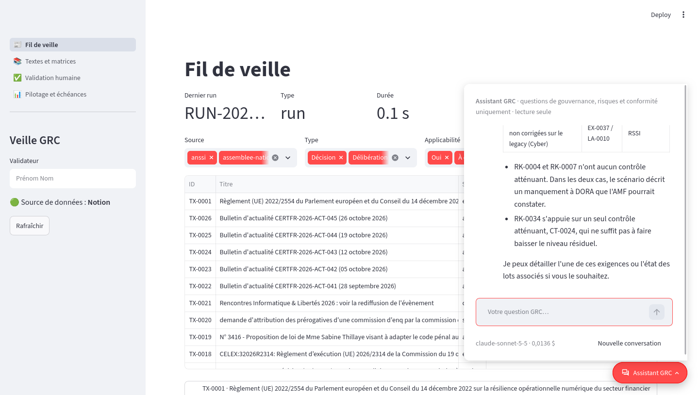

# Veille GRC : agent de veille continue législative et réglementaire

Projet d'atelier EPITA (Master, gouvernance des SI). Un agent TypeScript surveille des textes officiels
(DORA pour le MVP), en extrait des exigences vérifiables (article exact, extrait verbatim, URL officielle),
les stocke dans un store local puis dans Notion, produit des matrices GRC et un plan de gouvernance ; un
cockpit Streamlit permet la validation humaine. Cadrage complet dans [`SPEC.md`](SPEC.md), journal des
phases dans [`docs/journal.md`](docs/journal.md), architecture dans [`docs/architecture.md`](docs/architecture.md).

> État : rendu final (tag `rendu-final`). Parcours de démonstration (tag `atelier-4h`), veille multi-sources, pipeline
> d'analyse complet avec les cinq matrices, gouvernance et cockpit complet fonctionnent avec une clé API LLM et une intégration
> Notion (voir Configuration). Livrables : [`docs/demo-script.md`](docs/demo-script.md),
> [`docs/resultats-et-limites.md`](docs/resultats-et-limites.md), [`docs/presentation.md`](docs/presentation.md),
> [`docs/plan-gouvernance.md`](docs/plan-gouvernance.md), [`docs/matrices/`](docs/matrices/),
> [`docs/modele-de-donnees.md`](docs/modele-de-donnees.md).

## Prérequis

- Node.js **22 ou plus** (AI SDK 7 l'exige) et pnpm 12 (activé via corepack par `scripts/setup.sh`).
- Python 3.11 ou plus.
- Une clé API Anthropic (ou OpenAI / Mistral en changeant `LLM_PROVIDER`).
- Un compte Notion avec une intégration interne et une page parente partagée avec elle.
- Linux ou WSL2 ; les commandes se lancent depuis la racine du dépôt.

## Installation

```bash
scripts/setup.sh          # pnpm (corepack), dépendances Node, venv Python, copie de .env.example en .env
# renseigner .env, puis :
pnpm agent config         # vérifie .env, config/*.yaml et la présence du texte officiel
```

Installation manuelle équivalente :

```bash
corepack enable --install-directory "$HOME/.local/bin" pnpm   # si pnpm est absent (Node installé par apt)
pnpm install
python3 -m venv .venv && .venv/bin/pip install -r cockpit/requirements.txt
cp .env.example .env
```

## Configuration

| Variable                                                     | Rôle                                                                                     |
| ------------------------------------------------------------ | ---------------------------------------------------------------------------------------- |
| `LLM_PROVIDER`, `LLM_MODEL`, `LLM_EFFORT`                    | provider et modèle (défaut `anthropic` / `claude-opus-5-5` / `medium`)                   |
| `ANTHROPIC_API_KEY` (ou `OPENAI_API_KEY`, `MISTRAL_API_KEY`) | clé du provider choisi                                                                   |
| `LLM_CACHE`, `LLM_MAX_COST_PER_RUN`, `LLM_TIMEOUT_MS`        | cache des réponses (démo sans aléa), plafond de coût par run en dollars, délai par appel |
| `NOTION_TOKEN`, `NOTION_PARENT_PAGE_ID`                      | token d'intégration interne et page parente des 6 bases                                  |
| `PISTE_CLIENT_ID`, `PISTE_CLIENT_SECRET`, `PISTE_ENV`        | Légifrance et Judilibre (phase 2, optionnel)                                             |

**Notion** : créer une intégration interne sur https://www.notion.so/profile/integrations avec les capacités
_lire_, _mettre à jour_, _insérer du contenu_ et _insérer des commentaires_ ; créer une page vide, l'ouvrir,
menu « … » → _Connexions_ → ajouter l'intégration ; copier l'identifiant de la page (32 caractères hexadécimaux
à la fin de son URL) dans `NOTION_PARENT_PAGE_ID`. Les bases sont créées par `pnpm notion init`, leurs
identifiants sont écrits dans `notion/ids.json` (ignoré par git).

Les profils métier vivent dans `config/` : `organisation.yaml` (organisation cible fictive « Aurelia
Gestion d'Actifs »), `controles.yaml` (38 contrôles ISO 27001:2022 et internes), `risques.yaml` (grille
P × I), `sources.yaml` (sources et documents suivis).

Le texte officiel de démonstration est versionné dans `data/sources/dora-32022R2554-fr.html` (règlement
DORA, version française, page HTML EUR-Lex enregistrée depuis un navigateur : EUR-Lex bloque les
téléchargements automatisés). Ne jamais modifier les fichiers de `data/sources/`.

## Démo pas à pas (parcours de la section 3 de la spec)

```bash
# 1. Charger le texte officiel → TX-0001 dans data/store/textes.json (titre, référence, URL, hash, 64 articles)
pnpm agent ingest --file data/sources/dora-32022R2554-fr.html --source eurlex --ref CELEX:32022R2554 \
  --url "https://eur-lex.europa.eu/legal-content/FR/TXT/HTML/?uri=CELEX:32022R2554"

# 2 et 3. Extraire les exigences des articles 5 à 16 → EX-xxxx dans data/store/exigences.json
pnpm agent extract --texte TX-0001 --articles 5-16          # --dry-run pour voir les chunks sans appel LLM

# 4. Matrice M1 → output/matrices/M1-tracabilite.csv et .md
pnpm agent matrices --texte TX-0001 --only M1 --format csv,md

# 5. Notion : création des 6 bases (idempotent) puis push des textes et exigences (statut « À valider »)
pnpm notion init && pnpm notion push

# 6. Cockpit : vue « Validation humaine », boutons Valider / Corriger / Rejeter écrivant dans Notion
pnpm cockpit                                                 # http://localhost:8501
```

`pnpm agent demo` (ou `scripts/demo.sh`) enchaîne les étapes 1 à 5 avec le cache LLM activé ; `--skip-notion`
pour une démo hors ligne. Les réponses LLM des articles 5 à 16 sont déjà en cache sur la machine de développement
(`data/cache/llm/`, ignoré par git) : la démo y est instantanée et gratuite. Sorties attendues : un run `RUN-AAAAMMJJ-HHMM` dans `data/runs/` avec `metrics.json`
(durée, tokens, coût, compteurs), les artefacts de chaque chunk (prompt et réponse), et `pnpm agent status`
qui résume le dernier run.

Sans Notion, le cockpit fonctionne en lecture seule sur `data/store/` et refuse explicitement toute action de
validation (pas d'écriture silencieuse hors Notion).

## Pipeline d'analyse complet (phase 3)

```bash
pnpm agent run --texte TX-0001 --articles 5-16 --max-cost 12   # les huit étapes dans un run unique
pnpm agent run --texte TX-0001 --steps impact,coverage,risks     # une partie seulement
pnpm agent applicability --texte TX-0001                         # étapes individuelles : applicability, extract, enrich, jurisprudence
pnpm agent matrices --texte TX-0001 --only-validated             # M1 à M5 en CSV, XLSX et MD, exigences validées seulement
pnpm notion push && pnpm notion pull                             # contrôles, risques, jurisprudence, lots, relations ; retour des décisions
pnpm notion watch --interval 5                                   # worker push / pull périodique
```

Étapes : applicabilité (arrêt si le texte ne s'applique pas, sauf `--force`), extraction, enrichissement (échéances, sanctions,
destinataires depuis les articles transversaux), jurisprudence (Judilibre via `PISTE_API_KEY` ou corpus local
`data/sources/jurisprudence/*.json`, sinon étape ignorée et signalée), impact (listes fermées de `organisation.yaml`), couverture
(catalogue `controles.yaml`), risques (résiduel calculé par code avec `risques.yaml`), matrices. Mesuré sur DORA art. 5 à 16 :
28 appels, 2,91 $, 15 min avec `claude-opus-5-5`.

## Gouvernance et décision humaine (phase 4)

```bash
pnpm agent governance --texte TX-0001     # recommandation TOGAF / ITIL / Hybride, lots d'action, plan de gouvernance
pnpm agent ask "quelles exigences arrivent à échéance avant mars ?"   # bases Notion en langage naturel (serveur MCP Notion)
docker compose up --build                  # cockpit sur http://localhost:8501 + scheduler de veille
```

L'agent recommande (`output/gouvernance/recommandation.json`, `plan-gouvernance.md`) ; l'humain tranche dans la vue « Pilotage »
du cockpit : la décision est écrite dans Notion (lots d'action, page « Décision de gouvernance ») et dans
`output/gouvernance/decision.json`. Le serveur MCP Notion est aussi déclaré dans `.mcp.json` pour Claude Code (serveur hébergé,
authentification OAuth via `/mcp`).

## Assistant GRC du cockpit (phase 6)

Demande de l'enseignant, sur le modèle du template « Chatbot » de Vercel : un chat en langage naturel qui répond via l'API
Anthropic à partir des données du projet. Il est intégré au cockpit : la bulle « Assistant GRC », fixée en bas à droite de
toutes les pages, ouvre le panneau de conversation. `pnpm cockpit` suffit, sans application ni port supplémentaire.



- **Périmètre limité à la GRC.** Un filtre classe d'abord chaque question (`grc`, `salutation` ou `hors_perimetre`) par un
  appel court en sortie structurée, qui traite le message comme une donnée. Une question hors périmètre reçoit un refus sans
  que le modèle de réponse soit appelé : « Comment reverse une string ? », du code même présenté comme utile à DORA, de la
  culture générale ou une tentative de contournement. Les consignes du modèle de réponse rappellent ce périmètre.
- **Réponses tirées des données.** Neuf outils en lecture seule interrogent les données du cockpit (Notion, ou `data/store/`
  en repli) : `rechercher_exigences`, `detail_exigence`, `echeances`, `lister_risques`, `lister_lots`, `lister_controles`,
  `fil_de_veille`, `jurisprudence` et `indicateurs`. Les identifiants cités (EX-, RK-, LA-, CT-, TX-) viennent de ces
  lectures, et chaque appel d'outil s'affiche dans la conversation.
- **Lecture seule.** L'assistant ne valide, ne corrige et ne décide rien : il renvoie vers la vue du cockpit concernée.
- **Réglages** (`.env`) : `LLM_CHAT_MODEL` (sinon `LLM_MODEL`), `LLM_CHAT_EFFORT` (`low` par défaut), `LLM_CHAT_MAX_COST`
  (plafond par conversation, 1 $ par défaut) et `LLM_FALLBACKS=0` pour couper le repli serveur en cas de refus du modèle.
- **Coût mesuré** avec `claude-sonnet-5-5` : 0,003 $ par refus, 0,02 à 0,05 $ par réponse avec outils.

## Sources de veille (phase 2)

| Source              | Connecteur                                                    | Accès                                    | Activation                                          |
| ------------------- | ------------------------------------------------------------- | ---------------------------------------- | --------------------------------------------------- |
| EUR-Lex             | texte par CELEX (HTML officiel, repli Cellar), flux RSS du JO | sans clé                                 | `enabled: true`                                     |
| Légifrance          | PISTE OAuth2, `consult/legiPart`, `getArticle`, `search`      | `PISTE_CLIENT_ID`, `PISTE_CLIENT_SECRET` | `enabled: false` tant que les identifiants manquent |
| Judilibre           | PISTE, en-tête `KeyId`, `search`, `decision`                  | `PISTE_API_KEY`                          | idem                                                |
| Assemblée nationale | flux RSS officiels + pages                                    | sans clé                                 | `enabled: true`                                     |
| Sénat               | CSV open data des dossiers + flux RSS                         | sans clé                                 | `enabled: true`                                     |
| CNIL                | flux RSS officiel + pages                                     | sans clé                                 | `enabled: true`                                     |
| ANSSI / CERT-FR     | flux CERT-FR + pages                                          | sans clé                                 | `enabled: true`                                     |
| Fichier local       | HTML, PDF, TXT déjà téléchargés                               | —                                        | `enabled: true`                                     |

```bash
pnpm agent watch --once                    # un passage sur toutes les sources activées
pnpm agent watch --once --source cnil,senat
pnpm agent watch                           # planificateur cron (config/sources.yaml : cron par source)
```

Un texte nouveau ou modifié est ingéré avec hash, diff par article et historique ; les exigences validées qui
citent un article modifié passent « À revalider » (store puis Notion, avec commentaire d'audit). Mots-clés,
fenêtre initiale et plafond par passage sont réglables dans `config/sources.yaml`. L'alternative au scheduler
local est le workflow `.github/workflows/veille.yml` (secrets `ANTHROPIC_API_KEY`, `NOTION_TOKEN`,
`NOTION_PARENT_PAGE_ID`, `PISTE_*`).

Identifiants PISTE : inscription gratuite sur https://piste.gouv.fr (une application sandbox avec clé API et
identifiants OAuth est créée automatiquement ; cocher les API Légifrance et Judilibre dans « Consentement CGU »).

## Commandes

```bash
pnpm agent --help              # toutes les commandes de l'agent
pnpm agent config              # résumé de la configuration et des prérequis
pnpm agent status [--all]      # dernier run (durée, tokens, coût)
pnpm notion init|push          # workers Notion (pull et watch en phase 3)
pnpm cockpit                   # cockpit Streamlit
pnpm check                     # lint + typecheck + tests TypeScript
pnpm cockpit:test              # tests Python (pytest)
```

## Comment ça marche

- **Ingestion** : parser du HTML EUR-Lex (articles `id="art_N"`, titres, paragraphes et points a), b)), hash
  SHA-256 du contenu normalisé, copie brute horodatée dans `data/raw/`, IDs stables via `data/store/ids-registry.json`.
- **Extraction** : chunks par groupes d'articles (jamais coupés), un appel structuré par chunk
  (`generateText` + `Output.object`, schéma Zod `ExtractionResultSchema`, prompt versionné
  `agent/src/prompts/extraction.md`), fusion des doublons (clé article + titre, similarité de titres), puis
  vérification par code : existence des articles cités et extrait verbatim retrouvé par sous-chaîne normalisée.
- **Confiance** : `0,5 × LLM + 0,3 × verbatim retrouvé + 0,2 × article existant` ; sous 0,6 ou non vérifiée,
  l'exigence est marquée à relire en priorité, jamais supprimée.
- **Matrices** : projections déterministes du store (le LLM ne génère jamais une matrice).
- **Notion** : API data sources (2025-09-03), upsert par ID métier, relations bidirectionnelles, rate limit
  respecté ; les champs de validation humaine ne sont jamais écrasés par un push.
- **Cockpit** : lecture Notion des six bases avec cache de 60 s, repli local automatique, décisions écrites dans Notion
  (propriétés + commentaire d'audit `AAAA-MM-JJ HH:MM · Validée par … · motif`), matrices et graphiques rendus depuis les
  données, décision de gouvernance.

## Les quatre vues du cockpit

| Vue                   | Contenu                                                                                                                                                                                                                                                                                              |
| --------------------- | ---------------------------------------------------------------------------------------------------------------------------------------------------------------------------------------------------------------------------------------------------------------------------------------------------- |
| Fil de veille         | textes collectés avec badges « Nouveau » / « Modifié », filtres (source, type, applicabilité, période), dernier run (durée, coût), diffs par article des textes modifiés                                                                                                                             |
| Textes et matrices    | applicabilité et justification, tableau des exigences triable, graphiques (exigences par type, couverture, heatmap probabilité × impact), onglets M1 à M5 rendus depuis les données avec téléchargements CSV et XLSX                                                                                 |
| Validation humaine    | file « À valider » / « À revalider » triée par confiance puis échéance puis sanction, panneau de détail avec lien vers l'article officiel et les trois composantes de la confiance, actions Valider / Corriger / Rejeter écrites dans Notion avec commentaire d'audit                                |
| Pilotage et échéances | KPI (textes, exigences par statut, % vérifiées, % couverture, risques par niveau, lots par statut), timeline des échéances à 30 / 90 / 365 jours avec dépassements en rouge, lots d'action par priorité, recommandation de cadre de gouvernance et bouton de décision, exports XLSX et plan Markdown |

La bulle « Assistant GRC » (phase 6) est présente sur les quatre vues. Captures d'écran des vues : à réaliser par l'équipe
avec `pnpm cockpit` et à déposer dans `docs/captures/`, qui contient déjà celles de l'assistant.

## Dépannage

- **`pnpm` introuvable** : `corepack enable --install-directory "$HOME/.local/bin" pnpm` puis ajouter
  `~/.local/bin` au `PATH`.
- **Node trop ancien** : AI SDK 7 exige Node 22 ; vérifier `node --version`.
- **`Clé API manquante`** : renseigner `ANTHROPIC_API_KEY` dans `.env` ; `pnpm agent extract --dry-run`
  fonctionne sans clé.
- **Notion 401 / 403 / 404** : token invalide, capacités de l'intégration insuffisantes, ou page parente non
  partagée avec l'intégration (voir Configuration).
- **Garde-fou de coût atteint** : augmenter `LLM_MAX_COST_PER_RUN` (défaut 2 $). Mesuré le 27/10/2026 : l'extraction
  des articles 5 à 16 avec `claude-opus-5-5` (effort medium) coûte 1,23 $ et dure 7 min 46 s pour 85 exigences
  (39 103 tokens en entrée, 53 496 en sortie, raisonnement compris) ; le rejeu avec cache est gratuit et immédiat.
- **Cockpit lent sous WSL** : avec le dépôt sur `/mnt/c`, chaque import Python traverse le pont vers Windows. Le premier
  affichage prend ≈ 20 s, et le SDK Anthropic (≈ 2 500 modules) se charge ensuite en arrière-plan en ≈ 25 s. Cloner le dépôt
  dans le système de fichiers Linux (`~/…`) supprime ces délais. La surveillance des fichiers de Streamlit est désactivée
  (`.streamlit/config.toml`) : relancer `pnpm cockpit` après une modification du code.
- **Assistant GRC indisponible** : renseigner `ANTHROPIC_API_KEY` dans `.env`, puis relancer le cockpit.
- **Streamlit et Windows** : lancer les commandes depuis WSL2 ; `.venv\Scripts\streamlit run cockpit\app.py`
  depuis PowerShell si l'environnement a été créé sous Windows.
